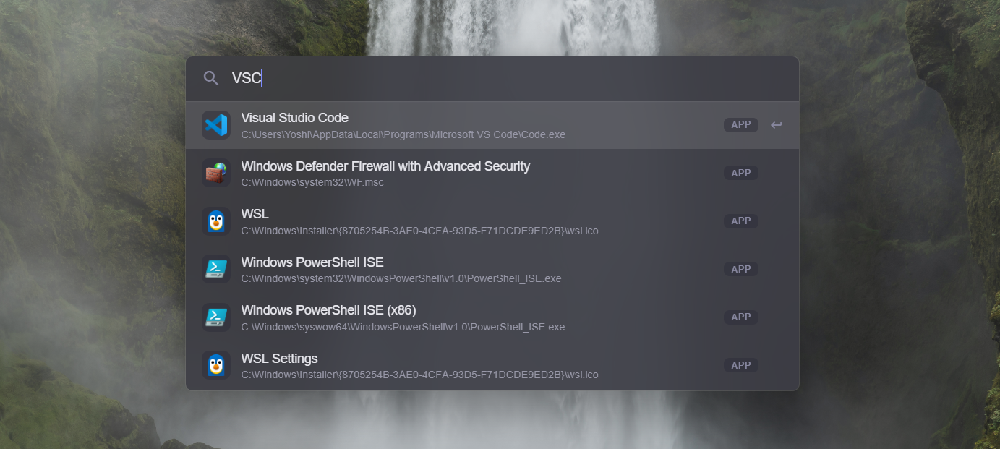
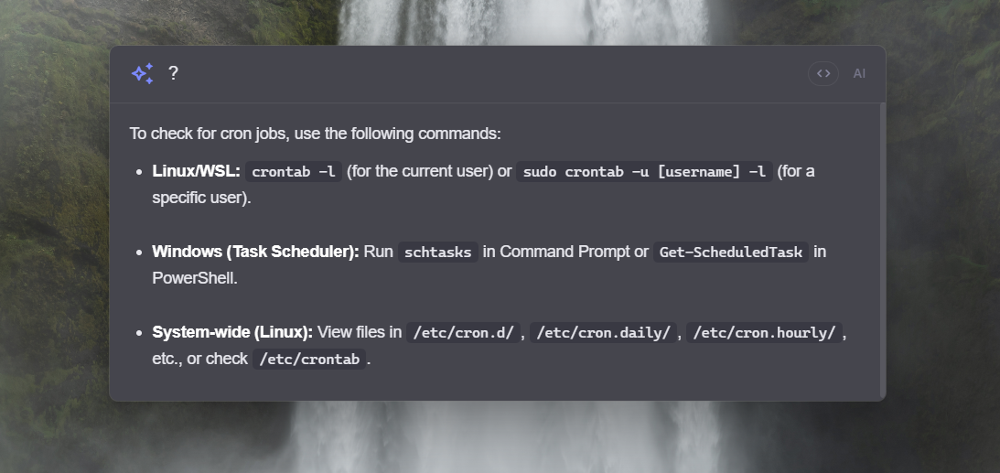
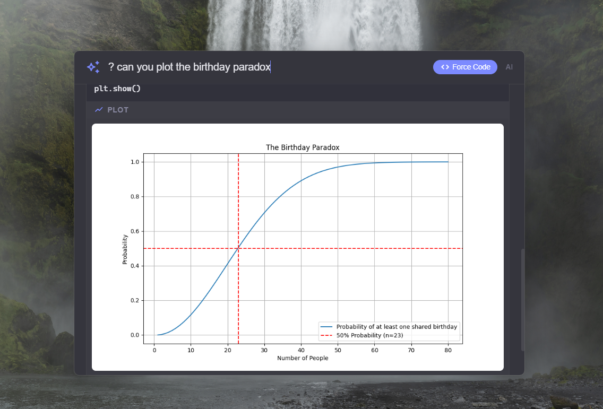
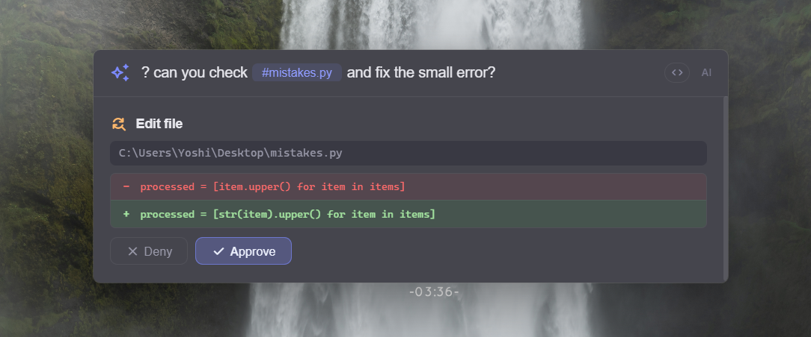
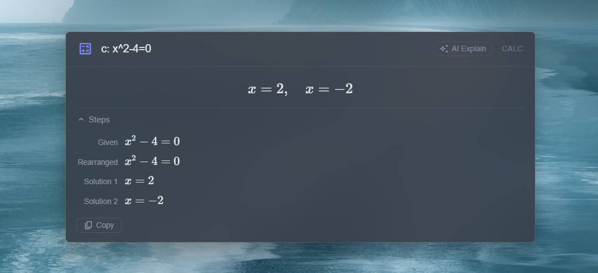
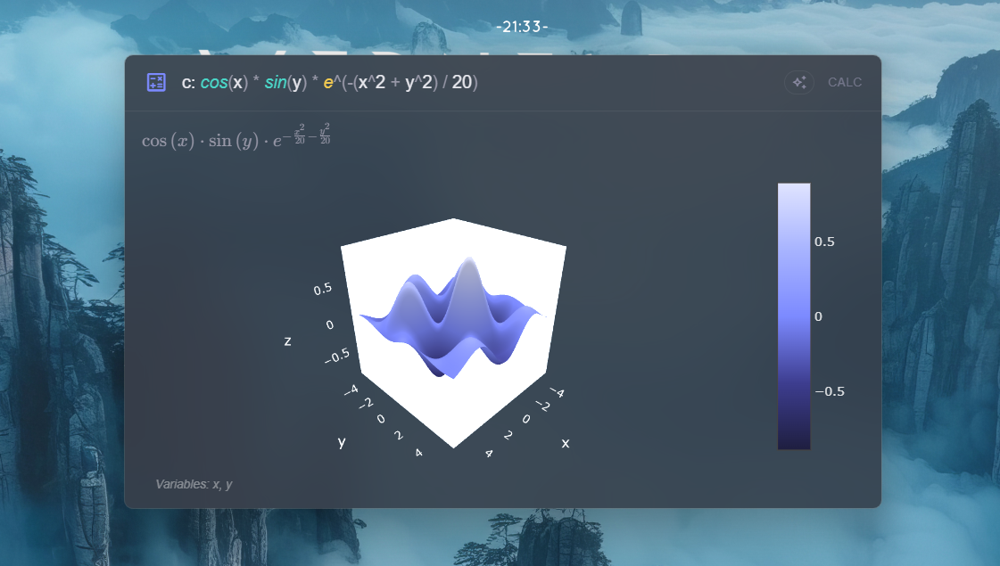
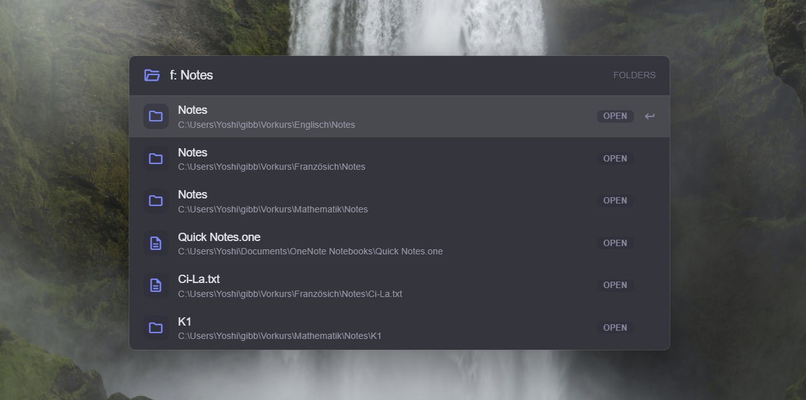

# TRIM

[](https://github.com/6A31/TRIM/releases/latest)
[](https://github.com/6A31/TRIM/releases/latest)
[](https://github.com/6A31/TRIM/releases/latest)
[](https://github.com/6A31/TRIM/releases/latest)

A launcher for Windows, macOS, and Linux. Spotlight-ish, but with AI.

On Windows and macOS, **Alt+Space** (Option+Space on Mac) toggles the bar. Change it in `/settings`. On Linux, TRIM can't register a global shortcut; you bind one in your window manager (see below). Frosted acrylic on Windows 11, otherwise it stays out of your way.



## Features

### App Search

Start typing to find apps. Results sort by how often you use them, and fuzzy matching works (`vsc` finds Visual Studio Code).

- **Windows**: Start Menu shortcuts + Microsoft Store / UWP apps
- **macOS**: `.app` bundles from `/Applications`, `/System/Applications`, and `~/Applications`
- **Linux**: `.desktop` entries from `~/.local/share/applications`, `/usr/share/applications`, Flatpak, Snap

### AI Chat

Prefix with `?` for Gemini Flash or `??` for Gemini Pro. Answers use live Google Search and render Markdown with syntax highlighting, LaTeX, and copy buttons on code blocks.

Press **Esc** (or click **Stop**) while an answer is generating to cancel it; Esc again hides the bar. Links in answers open in your default browser.

Follow-ups stay in the same chat. Clear the `?` (or run `/clear`) to archive and start fresh. Type `?` alone — or `/history` — to browse past conversations. Paste one or more screenshots with Ctrl+V; they stack as attachments until you send.



### Python Execution

The AI can install packages, run scripts, and return real output, not just plots. Packages live in a persistent environment so common libs (numpy, matplotlib, and friends) don't reinstall every query. **Force Code** makes every query run Python instead of letting the model guess.

Windows, macOS, and Linux builds can ship with a bundled Python runtime (it also runs the `c:` calculator's SymPy engine). Set `TRIM_SKIP_BUNDLED_PYTHON=1` to use system Python during development.



### File References

`#filename` in an AI query attaches that file as context. Text, PDFs, and images work.


### File Automation

The AI can read, create, edit, and delete files. Destructive changes show a diff and ask for confirmation first.



### Image Generation

Ask for an image and it shows up inline. Copy to clipboard or save from the hover buttons.


### Math

`c:` is a small computer algebra system powered by [SymPy](https://www.sympy.org), running locally (no API calls). TRIM only routes your input to SymPy and draws the result; parsing, simplification and solving are all SymPy's.

- `c: 2+2`, `c: sqrt(8)` → exact results with decimals (`2√2 ≈ 2.828`)
- `c: x^2-4=0` → solutions, including complex ones (`x^2-2x+5=0` → `1 ± 2i`)
- `c: (a+b)^2 = a^2+2ab+b^2` → recognised as always true; `c: x = x+1` → no solution
- `c: sin(x)=0` → the full periodic solution set (`2nπ`, `2nπ + π`)
- `c: expand((a+b)^2)`, `c: factor(x^2-4)`, `c: diff(x^3, x)`, `c: integrate(x^2, x)`, `c: limit(sin(x)/x, x, 0)`
- `c: sin(x)` → interactive 2D plot; `c: x^2+y^2` → 3D surface; `c: y = 2x+1` plots too

Functions follow normal bracket rules: `expand(a+b)^2` is `(a+b)^2`, while `expand((a+b)^2)` expands. The shorthand `derive x^3`, `integrate x^2 dx`, `factor x^2-4` also works.

**Quick math vs. the worksheet.** Plain arithmetic (`c: 2+3*4`, `c: sqrt(2)*pi`) shows an instant result; Enter copies it. Anything more (variables, equations, definitions, `ggT`/`kgV`, nested functions) opens the **worksheet**, a CAS editor like GeoGebra's CAS view:

- Every Enter adds a numbered row (`$1`, `$2`, ...) with its result. Invalid lines are never added; the error shows and your input stays so you can fix it.
- Reuse results: `$2` is row 2's result, `ans` the latest one. `kgv($1, 4, ggt(9, 12))`, `x^2 = $1`, `$3[0]` (first solution of row 3).
- Define with `:=`: `f(x) := x^2 + 1`, then `f(3)`, `g := expand(f(a+b))`, `diff(g, a)`, `f(f(x))`. A plain `=` is always an equation, never an assignment.
- ↑/↓ (or a click) edits an earlier row; Enter saves it and recalculates every row after it, Esc cancels. Each row has copy, plot and delete buttons; deleting renumbers later `$n` references.
- The worksheet is saved and comes back after a restart. `reset` + Enter starts a new one; `vars` lists your definitions.
- The window widens to 960 px for the worksheet (golden-ratio tall, up to 80% of the screen) and returns to the normal 810 px bar afterwards.

If your expression has variables, they show under the result (handy for catching `syn` vs `sin`). Glued letters multiply (`2ab` = `2·a·b`), but a function name glued to a letter is refused rather than guessed (`xsin(x)` asks you to write `x*sin(x)`). Anything SymPy can't do in 8 seconds is stopped instead of freezing the bar.

The first calculation after TRIM starts takes about a second while SymPy loads. Release builds ship SymPy inside the bundled Python; when running from source, TRIM installs the pinned SymPy once into its data folder.

<details>
<summary><strong>Calculator conventions</strong></summary>

| Input | Meaning |
|-------|---------|
| `^` | Power (`2^10` → 1024) |
| `%` | Percent, always (`200 * 50%` → 100, `50%2` → 1). Modulo is `mod(7, 3)` |
| `log(x)` / `lg(x)` | Base-10 logarithm; `log(x, b)` for base b |
| `ln(x)` | Natural logarithm |
| `e`, `i`, `pi`, `oo` | Euler's number, imaginary unit, π, infinity |
| `5!` | Factorial |
| `round(x)` | Rounds half away from zero (`round(2.5)` → 3) |
| `cbrt(x)` | Real cube root (`cbrt(-8)` → -2) |
| `gcd` / `ggT`, `lcm` / `kgV` | Two or more whole numbers (`ggt(12, 8, 4)` → 4); non-integers are an error |
| `sin`, `cos`, `tan`, ... | Radians; degrees with `°` or `deg` (`sin(30°)` → 1/2, `asin(1/2)/deg` → 30). `sin^2(x)` works |
| `π √ ² ³ × · ÷` | Typed symbols work: `2π`, `√2`, `x²`, `3×4`, `8÷2` |
| `:=` | Define a value or function (Enter to store) |
| `=` | Equation: solve it (or `true`/`false` when there are no variables) |

Everything else is plain SymPy: any SymPy function name works (`apart`, `series`, `Matrix`, `det`, `factorint`, `isprime`, ...).

</details>





### Folder Search

`f: report` searches Desktop, Documents, Downloads, and any extra paths you add in settings.



## Quick Reference

| Prefix | Mode | | Key | Action |
|--------|------|-|-----|--------|
| *(none)* | App search | | **Alt+Space** (Win/mac) | Toggle TRIM |
| `?` | AI Flash | | **Escape** | Hide |
| `??` | AI Pro | | **Up/Down** | Navigate |
| `c:` | Math | | **Enter** | Execute |
| `f:` | Folders | | **Tab** | Autocomplete |
| `/` | Commands (`/settings`, `/clear`, `/history`, …) | | **Ctrl+V** | Paste images into AI |

On Linux, bind your compositor to `"$APPIMAGE" --toggle` (or the full AppImage path). See **Install**.

## Install

### Windows / macOS

Download from [Releases](https://github.com/6A31/TRIM/releases/latest):

- **Windows**: run the `.exe` installer
- **macOS**: open the `.dmg` and drag TRIM to Applications

### Linux

Linux builds are AppImages only (no `.deb` or `.rpm` yet).

1. Download `TRIM-…-Linux-x86_64.AppImage` from [Releases](https://github.com/6A31/TRIM/releases/latest).
2. Move it somewhere permanent and `chmod +x` it.
3. On Arch you might need `sudo pacman -S fuse2`.
4. Run it once.

TRIM has to stay running for toggles to work. Autostart it hidden:

```bash
"/path/to/TRIM.AppImage" --hidden
```

Or turn on **Launch on startup** in `/settings` (packaged builds pass `--hidden` automatically).

Bind a key in your compositor:

```bash
"/path/to/TRIM.AppImage" --toggle
```

Hyprland example:

```
bind = SUPER, SPACE, exec, "/path/to/TRIM.AppImage" --toggle
```

Each keybind exec spins up a short helper process (AppImage mount + Electron). ~150ms before toggle on packaged builds. Normal.

Escape closes the bar. Click-away dismiss is off on Linux so tiling WMs and focus-follows-mouse don't close it accidentally. Set `TRIM_LINUX_BLUR_DISMISS=1` if you want click-away back.

`/settings` on Linux shows your paths and copies the commands if you're already running the AppImage.

### From source

```bash
git clone https://github.com/6A31/TRIM.git
cd TRIM
npm install
npm start
```

You'll need [Node.js LTS](https://nodejs.org/). For AI, grab a free [Gemini API key](https://aistudio.google.com/apikey) and paste it in via `/settings`.

Dev toggle from the repo: `npx electron . --toggle` (separate config from the packaged app).

The calculator needs Python 3 with SymPy. From source, TRIM installs the pinned version (`sympy==1.14.0`) into its data folder on first use, so an internet connection is needed once.

Tests: `npm test`. The calculator tests run against the real SymPy engine and are skipped if Python can't import SymPy; either `pip install sympy==1.14.0`, or point `TRIM_CAS_LIB` at a folder made with `pip install --target <folder> sympy==1.14.0`.

## Building

```bash
npm run build:win      # Windows (.exe installer)
npm run build:mac      # macOS (.dmg)
npm run build:linux     # Linux (AppImage)
```

## Stack

Electron 41, vanilla JS (no frameworks), [@google/genai](https://www.npmjs.com/package/@google/genai) for Gemini 3 Flash / 3.1 Pro, bundled Python for local code execution, [SymPy](https://www.sympy.org) for the calculator, KaTeX and Plotly for math rendering and plots.

## License

TRIM Non-Commercial No-Derivatives License (see `LICENSE`).
